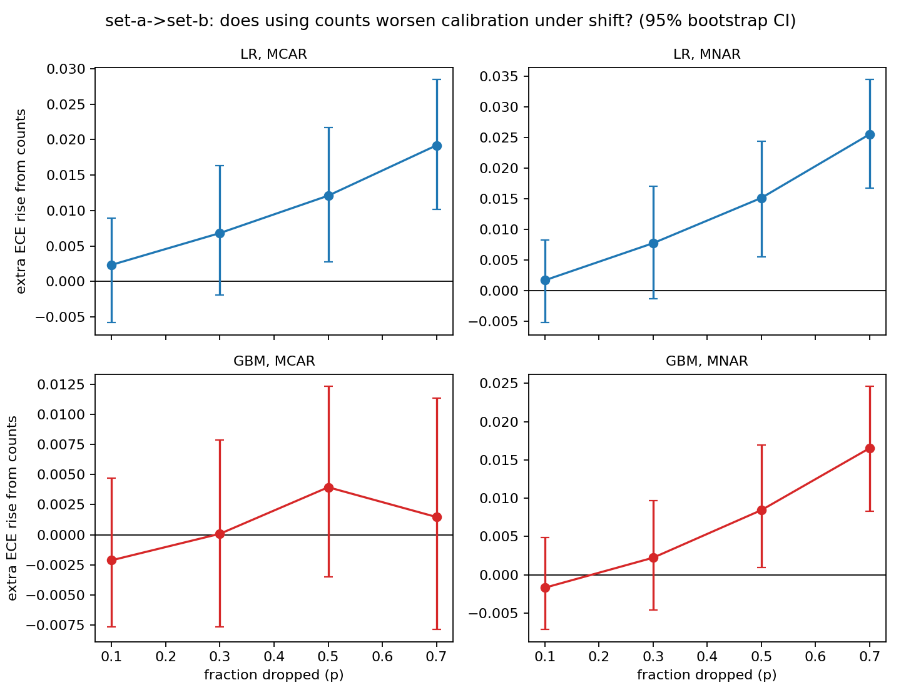
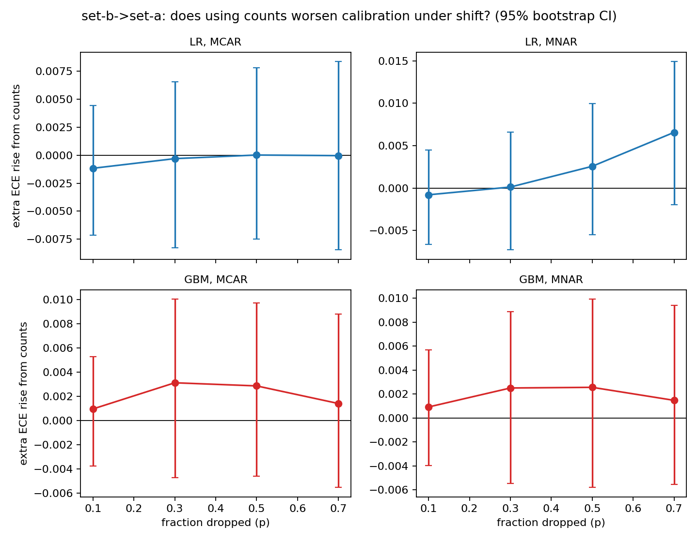

# Does using observation counts hurt calibration under missingness shift? (PhysioNet 2012)

A small, fully reproducible pilot study on ICU in-hospital mortality prediction. It asks whether models that use
*how often* variables were measured (observation counts) lose calibration faster than values-only models when the
missingness pattern shifts. **The headline finding is negative: the effect appeared in one train/test direction
and did not replicate when the sets were swapped, so no general claim is made.**

## Question and hypothesis

**H1.** Models that use observation counts are better calibrated in-distribution but degrade faster in ECE under
a shift in observation rate than values-only models.

## Data

[PhysioNet/Computing in Cardiology Challenge 2012](https://physionet.org/content/challenge-2012/1.0.0/), sets a and b
(4,000 ICU stays each, in-hospital mortality about 14%). The data are **not included** in this repository; the script
downloads them from PhysioNet. Sets a and b are random splits of the same cohort, so the "shift" below is simulated.

## Method

- Features per patient: last / mean / min / max / log1p(count) for each time-varying variable, plus static descriptors.
- Models: logistic regression and gradient boosting, each with **values only** or **values + counts**.
- Train on one set; test on the other after removing test measurements:
  - **MCAR**: each measurement removed with probability p.
  - **MNAR**: measurements with |z| < 1 (normal-looking values) removed with probability p.
  - p in {0.1, 0.3, 0.5, 0.7}; 5 random-removal seeds.
- Metrics: AUROC, Brier score, ECE (10 equal-mass bins), calibration-in-the-large (mean prediction minus observed rate).
- Key contrast: extra ECE increase caused by counts = dECE(values+counts) - dECE(values), with 95% bootstrap CIs
  over test patients (200 resamples).
- Recalibration arm: refit an intercept, or Platt slope + intercept, on half of the shifted test patients and score the other half.
  This uses labels from the shifted data, so it is an upper bound on what is fixable without labels.

## Results

Extra ECE increase from using counts (95% bootstrap CI), at p = 0.7:

| shift | model | set-a -> set-b | set-b -> set-a |
|---|---|---|---|
| MCAR | LR | +0.0192 [0.0101, 0.0285] | -0.0000 [-0.0085, 0.0084] |
| MCAR | GBM | +0.0015 [-0.0079, 0.0113] | +0.0014 [-0.0055, 0.0088] |
| MNAR | LR | +0.0255 [0.0167, 0.0344] | +0.0066 [-0.0020, 0.0149] |
| MNAR | GBM | +0.0165 [0.0083, 0.0246] | +0.0015 [-0.0055, 0.0094] |

- **Set-a -> set-b:** the effect is present for logistic regression (both shifts) and for GBM under MNAR at p >= 0.5.
- **Set-b -> set-a:** all 16 intervals include zero. The effect does not replicate.
- **Clean data:** counts give a small gain in AUROC (about +0.002 to +0.009) and Brier, with no consistent ECE difference.
- **Direction of bias is not stable:** set-a -> set-b shifts produce over-prediction; in set-b -> set-a the GBM models under-predict.
- **Recalibration** helps where miscalibration was large (set-a -> set-b, LR + counts, MNAR p = 0.7: ECE 0.0738 -> 0.0261
  with an intercept, 0.0148 with Platt), and does little in set-b -> set-a, where it sits near the noise floor.




## Interpretation and limitations

- The result depends on which half of the data trains the model. A single split would have suggested a robust effect.
- The shift is simulated (random subsampling of measurements), not a natural distribution shift between hospitals.
- Models use summary features, not raw irregular time series; this is not a reproduction of any irregular-time-series model.
- "Seeds" vary only the random removal (training is deterministic), so seed spread is not test-set uncertainty; use the bootstrap CIs.
- ECE on half the test set (recalibration arm) has a higher noise floor, roughly 0.02.
- A third replication (train on set-a, test on set-c) was not run: set-c files were not available in my run.
- I have not done a literature review, so I make no novelty claim.

## Reproduce

```bash
pip install -r requirements.txt
python pilot.py --seeds 5 --boot 200            # downloads data, runs a->b, b->a (and a->c if set-c is available)
python pilot.py --synthetic --data_dir synth_raw   # pipeline test on fake data; results meaningless
```

Outputs go to `results_v2/`. A full run takes roughly 10-20 minutes on a free Colab CPU.

## Possible next steps

Pool sets a and b and run many random resplits to estimate how often the effect appears; ask the same question of models
that read the irregular series directly; test whether the effect is explained by differences in fitted count coefficients.

## Notes

Code written with assistance from Claude (Anthropic). Licensed under MIT. Author: Pascal Desouza.
